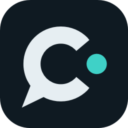

<p align="center">
  
</p>

<h1 align="center">Cue</h1>

<p align="center">
  Тихий помічник для дзвінків і співбесід під Windows.<br>
  Слухає співрозмовника і за натисканням клавіші підказує коротку відповідь.<br>
  У демонстрації екрана його не видно.
</p>

<p align="center">
  <a href="https://github.com/San4o-0/cue_invisibleAIagent/releases/latest/download/Cue.exe"><b>⬇ Завантажити Cue.exe</b></a>
  &nbsp;·&nbsp;
  <a href="https://github.com/San4o-0/cue_invisibleAIagent/releases">Усі версії</a>
</p>

---

## Що вміє

- **Підказує відповідь.** Натискаєш гарячу клавішу (за замовчуванням `Alt + ~`), і Cue бере останні секунди розмови та дає коротку відповідь на питання, яку можна сказати вголос.
- **Розпізнає розмову наживо.** Слухає звук комп'ютера: Zoom, Teams, Meet, Discord, відео. Твій мікрофон не записується. Розуміє технічні терміни на кшталт SOLID, LINQ чи Docker.
- **Невидимий у демонстрації.** Ти бачиш вікно, а в демонстрації екрана, на записі й на скріншотах його немає. Перемикається кнопкою з оком.
- **Знає твої матеріали.** Додай резюме, нотатки або цілу папку проєкту, і Cue спиратиметься на них у підказках.
- **Не заважає.** Прозорий фон, закріплення поверх вікон і компактний режим «Лише підказки».
- **Налаштовується.** Свої інструкції для підказок, мова розмови й мова підказок окремо (українська, англійська, польська, німецька та інші).

## Як почати

1. **Завантаж** [Cue.exe](https://github.com/San4o-0/cue_invisibleAIagent/releases/latest/download/Cue.exe). Встановлювати нічого не треба, це один файл.
2. **Запусти.** Windows може показати синє вікно «Windows захистив ваш ПК», бо програма нова й не має платного підпису. Натисни **«Докладніше» → «Виконати однаково»**.
3. **Встав ключ OpenAI.** При першому запуску Cue сам відкриє налаштування. Ключ створюється на [platform.openai.com/api-keys](https://platform.openai.com/api-keys), а на рахунку OpenAI мають бути кошти.
4. **Почни дзвінок** і натисни `Alt + ~`, коли прозвучить питання. Підказка з'явиться праворуч.

Щоб оновитися, просто завантаж новий `Cue.exe` і заміни старий. Налаштування й ключ збережуться.

## Вимоги

- Windows 10 (версія 2004 або новіша) чи Windows 11, 64-біт
- Акаунт OpenAI з коштами на рахунку. Cue працює через твій ключ, тож платиш напряму OpenAI за те, що використав.

## Приватність

- Звук співрозмовника й текст розмови надсилаються в OpenAI, щоб розпізнати мову та підготувати підказку. Більше нікуди.
- Ключ OpenAI зберігається зашифрованим засобами Windows. Прочитати його може тільки твій обліковий запис на цьому комп'ютері.
- Записи розмов і налаштування лежать у `Документи\LiveTranscriber`. Їх можна будь-коли видалити.

## Часті питання

**Антивірус свариться на Cue.exe.**
Деякі антивіруси насторожено ставляться до нових програм без підпису, які приховують вікно від запису екрана. Код повністю відкритий у цьому репозиторії, а `Cue.exe` збирається з нього автоматично на серверах GitHub.

**Співрозмовник побачить Cue, якщо я покажу весь екран?**
Ні, поки око в заголовку синє й перекреслене. Помаранчеве око означає, що Cue зараз видно в демонстрації.

**Чому не чути мене самого?**
Cue слухає лише звук, який іде з комп'ютера, тобто співрозмовника. Так задумано.

---

## Для розробників

Потрібен .NET 10 SDK.

```
dotnet run
```

Зібрати один `exe`, як у релізах:

```
dotnet publish -c Release -r win-x64 --self-contained true -p:PublishSingleFile=true -p:AssemblyName=Cue -o dist
```

Новий реліз створюється автоматично: досить запушити тег версії, і GitHub Actions збере `Cue.exe` та опублікує його в Releases.

```
git tag v1.0.0
git push origin v1.0.0
```

Додаткові налаштування через змінні середовища: `OPENAI_API_KEY`, `OPENAI_MODEL` (за замовчуванням `gpt-4o-mini`), `OPENAI_TRANSCRIBE_MODEL` (`gpt-4o-transcribe`), `OPENAI_BASE_URL`. Словник термінів для розпізнавання можна розширити, поклавши свій `terms.txt` поруч із `Cue.exe`.

Шрифт Manrope поширюється за ліцензією [SIL Open Font License](Fonts/OFL.txt).
